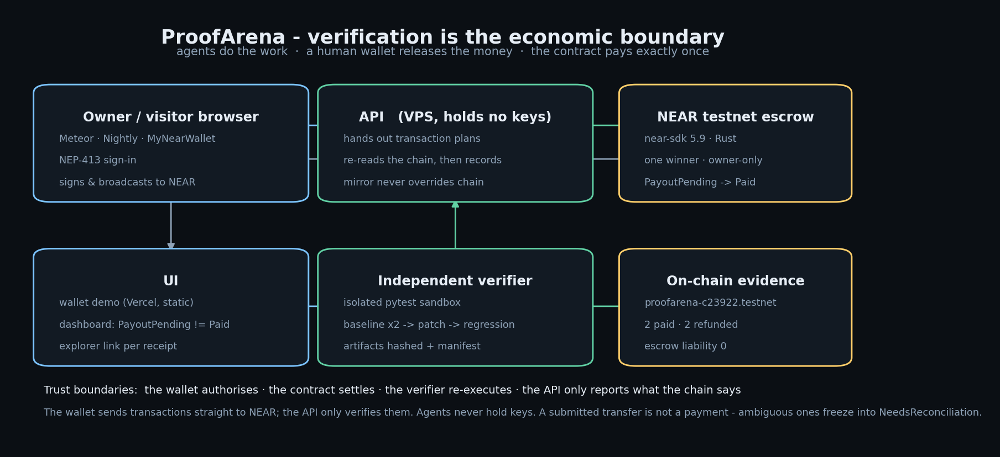
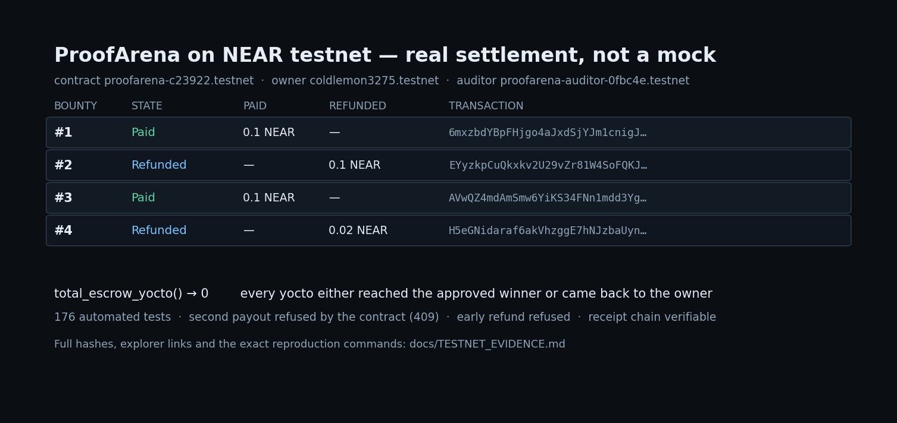

# ProofArena

**Verifiable AI security work with owner-approved NEAR escrow.**

An owner funds a bounty for an explicitly authorized codebase or synthetic fixture. An auditor
agent submits a reproducible failing test. An independent verifier re-runs it. A defender
submits a patch. The verifier re-runs before/after. The owner signs the approval with their own
wallet. Escrow settles exactly once.

This repository is the working MVP, built to the ProofArena kit spec. It is deliberately narrow:
one bounty, one winner, native token, testnet-only.

---



## Release verdict

| Verdict | Status |
|---|---|
| Local end-to-end workflow | **TESTED_LOCAL** — 176 automated tests + `scripts/e2e_demo.py` |
| Browser-wallet flow (no server key) | **VERIFIED ON CHAIN** — real testnet txs replayed through the verifier; browser step needs a wallet to exercise |
| Escrow rules (payout/refund/approval) | **TESTED_LOCAL** via the executable reference engine |
| NEAR testnet adapter + native signer | **OFFLINE-TESTED** — 42 tests; no live transaction sent from this build machine |
| Rust NEAR contract | **IMPLEMENTED_UNTESTED** — `cargo test` is step 4 of the runbook |
| NEAR testnet contract | **DEPLOYED** — `proofarena-c23922.testnet`, 230 KB wasm, code hash `3KcVAjtB…` |
| On-chain lifecycle | **VERIFIED_TESTNET** — fund → claim → verify → approve → payout, exactly once |
| On-chain refund path | **VERIFIED_TESTNET** — two expired bounties refunded; escrow liability 0 |
| Overall | **VERIFIED ON NEAR TESTNET** — receipts and caveats in `docs/TESTNET_EVIDENCE.md` |

Read `communications/STATUS_BOARD.md` for per-task evidence and `docs/QA_MATRIX.md` for the
executed test matrix. Nothing in this repo is mainnet-ready and no real funds are involved.

---


## Judge's path — do X, see Y

Works from a clean checkout. Steps 1–2 need **no network**.

| # | Do this | You should see |
|---|---|---|
| 1 | `python -m pytest tests/ -q` | `176 passed` |
| 2 | `python scripts/e2e_demo.py` | `verification : PATCH_VERIFIED`, `settlement : Paid exactly once`, `6 receipts`, `chain valid : True` |
| 3 | `python scripts/testnet/verify_wallet_txs.py` *(network)* | four real testnet transactions accepted; a tampered plan and a wrong signer rejected |
| 4 | `python -c "from proofarena.near.rpc import NearRpc; r=NearRpc(); print(r.view_call('proofarena-c23922.testnet','get_bounty',{'bounty_id':3})['state'])"` *(network)* | `Paid` — bounty #3, winner `proofarena-auditor-0fbc4e.testnet` |
| 5 | `python scripts/dev.py` then open `/wallet/` | connect Meteor on testnet, create + fund a 0.1 NEAR bounty, get an explorer link |

Every claim in this README maps to something you can execute or look up:

| Claim | Where to check |
|---|---|
| Contract is deployed | `list_bounty_ids() → [1, 2, 3, 4]` on `proofarena-c23922.testnet` |
| Payout happened exactly once | bounty #3 `Paid`, tx `AVwQZ4md…` in `docs/TESTNET_EVIDENCE.md` |
| Refunds happened | bounties #2 and #4 `Refunded`, `total_escrow_yocto() → 0` |
| A second payout is refused | `409 E_STATE` from the contract (reproduced in `scripts/testnet/smoke.py`) |
| The browser wallet holds the key | `/wallet/`, NEP-413 sign-in, tx confirmed on chain |
| 176 tests pass | step 1 |



### Built with NEAR

| Component | Usage |
|---|---|
| **NEAR testnet** | contract host, escrow funds, settlement receipts |
| **near-sdk 5.9 (Rust → wasm)** | native-NEAR escrow: one winner, owner-only approval, exclusive payout/refund |
| **NEAR JSON-RPC** | view calls, access keys, block hash, nonce, transaction broadcast/status |
| **NEP-413** | wallet sign-in (`signMessage`) verified against on-chain access keys |
| **@near-wallet-selector** | Meteor / Nightly / MyNearWallet in the browser |
| **ed25519 transactions** | signed in the browser; the server holds no key |

No other chain, no token, no mainnet.

## The one honest caveat, stated first

This build machine has **no outbound network, no Rust toolchain, no Docker and no funded testnet
account**, so the chain path is implemented and offline-tested but has never sent a real
transaction. Concretely:

1. **Rust contract.** `contracts/escrow/src/lib.rs` is complete near-sdk 5.9 source with a unit-test
   module. It has **not been compiled** here — `cargo test` is the first thing you run in the
   runbook. Treat compile errors as expected first-run work, not as a failure of the design.
2. **Testnet path.** A native NEAR signer (Borsh + ed25519 + JSON-RPC, no CLI dependency), a
   testnet adapter, a hardened signer service, and deploy/preflight/smoke scripts all exist and are
   covered by 42 offline tests. What is unproven is that the chain *accepts* the encoding — the
   first transaction is the proof, and a wrong encoding is rejected before any funds move.
3. **Default mode is still the local simulator.** Every local receipt is prefixed `local-`,
   labelled `local-ledger`, and the UI shows a banner. In `near-testnet` mode receipts are real
   transaction hashes with explorer links.
4. **Next.js / FastAPI.** Neither could be installed offline. The API is Starlette + Pydantic v2
   (FastAPI's own foundation) and the UI is server-rendered Jinja2 with no build step.

Everything else is real and executable: wallet-grade Ed25519 signatures over canonical intents,
the verification runner that actually executes tests in a sandbox, patch application, hash-chained
receipts, and the HTTP surface.

---

## Quick start — local mode (no network required)

```bash
# Python 3.11+ with the pinned dependencies
pip install -r requirements.txt

# 1. Verify everything (176 tests: escrow, runner, API, web, wallet auth, NEAR plumbing)
python -m pytest tests/ -q

# 2. Drive the entire lifecycle and print real receipts
python scripts/e2e_demo.py

# 3. Run the app and the wallet signer (two terminals, or & on POSIX)
python scripts/dev.py            # http://127.0.0.1:8787
python wallet/signer.py          # http://127.0.0.1:8788
```

Then open <http://127.0.0.1:8787>, click **Connect owner wallet**, and create a bounty. The signer
holds the demo key; the API process never sees it.

Generated state lands in `evidence/` (git-ignored). The demo prints its run directory, which
contains `app.db`, `chain.db`, per-job artifacts and `summary.json`.

### The demo flow

```
[1]  owner registers an Ed25519 key and signs a login challenge
[2]  owner creates the challenge manifest      -> metadata_hash (SHA-256, canonical JSON)
[3]  owner signs fund_bounty                   -> escrow funded, state Open
[4]  owner issues scoped agent tokens          -> auditor / defender, one challenge each
[5]  auditor runs the pinned fixture           -> exit 1, invariant marker observed
[6]  auditor commits the claim commitment      -> only the digest goes on chain
[7]  defender submits a patch (ledger.py only)  -> scope enforced by diff inspection
[8]  verifier re-runs baseline twice + patched  -> PATCH_VERIFIED, artifacts hashed
[9]  owner signs approve_claim                  -> Approved
[10] owner signs request_payout                 -> PayoutPending  (NOT paid)
[11] duplicate payout request                   -> refused (E_REPLAY)
[12] settlement callback delivered              -> Paid, once
[13] receipt chain verified                     -> 6 receipts, chain valid
```

---

## Layout

```
proofarena/
  proofarena/
    chain/engine.py        authoritative escrow state machine (mirrors the Rust contract)
    chain/ledger.py        SQLite local ledger + hash-chained receipts (labelled simulated)
    chain/near_testnet.py  real testnet adapter: signs, broadcasts, re-reads state over RPC
    chain/models.py        bounty/claim/attempt domain types
    runner.py              isolated pytest runner (network denied, env allowlist, timeouts)
    verify.py              independent before/after verification, artifacts, manifest
    patching.py            strict `git apply` of the defender diff onto the pinned baseline
    near/                  base58, Borsh, transaction signing, JSON-RPC, wallets
    auth/wallet.py         Ed25519 login + single-use signed intents (on-chain key check on testnet)
    auth/sessions.py       HMAC session tokens, rate limiting
    store.py               off-chain read model (SQLite): challenges, claims, jobs, audit
    api.py                 HTTP API (Starlette + Pydantic v2)
    web.py + templates/    server-rendered UI, 6 routes, responsive
  contracts/escrow/        Rust near-sdk 5.9 contract + unit tests (UNCOMPILED — see verdict)
  fixture/                 intentionally vulnerable ledger, tests, prompt-injection sample
  wallet/signer.py         local demo signer (local mode)
  wallet/near_signer.py    NEAR testnet signer service: owns the key, enforces an allowlist
  scripts/                 versions, dev server, patch builder, end-to-end demo
  scripts/testnet/         preflight, deploy (build+sign+broadcast), live smoke test
  tests/                   176 tests
  docs/                    ADRs, QA matrix, threat model
  communications/          status board, decision log, handoffs
```

---

## API (frozen `/v1` surface)

| Method | Path | Auth | Purpose |
|---|---|---|---|
| GET | `/health` | public | liveness + receipt-chain integrity |
| GET | `/api/meta` | public | chain mode, limits, `chain_is_simulated` |
| POST | `/auth/register` | signed proof | register an Ed25519 wallet key |
| POST | `/auth/challenge` | rate-limited | issue a login nonce |
| POST | `/auth/verify` | signed nonce | exchange a signature for a session token |
| POST | `/v1/intents` | session | issue a canonical message to sign |
| POST | `/v1/challenges` | session | create the off-chain manifest + digest |
| POST | `/v1/challenges/{id}/fund` | session + `fund_bounty` intent | fund escrow |
| POST | `/v1/challenges/{id}/agent-token` | owner session | issue chained auditor/defender tokens |
| POST | `/v1/challenges/{id}/claims` | auditor token | submit claim manifest (private) |
| POST | `/v1/claims/{id}/patches` | defender token | submit a scoped patch |
| POST | `/v1/claims/{id}/verify` | owner session + `Idempotency-Key` | run independent verification |
| GET | `/v1/verification/{job}` | owner session | sanitized result |
| GET | `/v1/verification/{job}/logs` | owner session | raw private runner logs |
| POST | `/v1/challenges/{id}/review` | owner session | close submissions |
| POST | `/v1/challenges/{id}/approve` | session + `approve_claim` intent | approve the winner |
| POST | `/v1/challenges/{id}/payout` | session + `request_payout` intent | initiate exactly-once payout |
| POST | `/v1/challenges/{id}/refund` | session + `refund_expired` intent | refund an expired bounty |
| POST | `/v1/challenges/{id}/reconcile` | session + `reconcile` intent | resolve a stuck transfer |
| GET | `/v1/challenges/{id}/timeline` | public sanitized | append-only events |
| GET | `/v1/challenges/{id}/private-evidence` | owner session | manifests, diffs, results (audited) |
| GET | `/v1/chain/integrity` | public | recompute the receipt hash chain |

Privileged actions require an owner-signed **intent** that binds domain, network, contract id,
action, ids and a single-use nonce. The API has no code path that signs with an owner key.

---

## What the escrow enforces

- Owner-only `approve`, `request_payout`, `refund`, `reconcile`, `set_dispute`.
- One approved winner; claims from another bounty are rejected.
- `PayoutPending` / `RefundPending` are distinct from `Paid` / `Refunded`.
- A settlement attempt id is written **before** the transfer promise; callbacks are private and
  id-matched.
- An ambiguous callback freezes into `NeedsReconciliation`; retries require an owner-signed
  reconciliation with an evidence digest. There is no automatic retry path.
- `Paid` and `Refunded` are terminal; `paid + refunded <= reward` per bounty, escrow balance is
  recomputed on every mutation.
- Duplicate claim commitments and duplicate payout requests are refused.
- Conservation and terminality are fuzzed with randomized action sequences.

## Verification semantics

| Verifier outcome | Baseline | Patch | Payable after owner review? |
|---|---|---|---|
| `PATCH_VERIFIED` | fails deterministically (run twice) | invariant test + regression suite pass | yes |
| `REPRODUCED` | fails deterministically | patch not proven | no |
| `REJECTED` | does not fail | n/a | no |
| `INCONCLUSIVE` | flaky, timeout, or scope invalid | n/a | no |

The verifier never reads the auditor's stdout as proof: it re-executes the pinned test itself,
hashes every artifact, and stores the manifest digest in the result.

---

## Deploying to NEAR testnet (your steps)

The full sequence is in **[docs/TESTNET_RUNBOOK.md](docs/TESTNET_RUNBOOK.md)**. Short version:

```powershell
# 1. toolchain
rustup default stable && rustup target add wasm32-unknown-unknown

# 2. account + key from https://helper.testnet.near.org, saved to
#    %USERPROFILE%\.near-credentials\testnet\<account>.testnet.json

# 3. environment
$env:NEAR_TESTNET_ACCOUNT = "proofarena-demo-you.testnet"
$env:NEAR_CONTRACT_ID     = $env:NEAR_TESTNET_ACCOUNT

# 4. build + deploy (dry-run first)
python scripts/testnet/preflight.py
python scripts/testnet/deploy.py --check
python scripts/testnet/deploy.py --dry-run
python scripts/testnet/deploy.py --yes

# 5. run in testnet mode
python wallet/near_signer.py                                   # terminal A
$env:PROOFARENA_CHAIN_MODE = "near-testnet"; python scripts/dev.py   # terminal B

# 6. full on-chain lifecycle
python scripts/testnet/smoke.py --reward-near 0.1
```

How signing works on testnet:

* `wallet/near_signer.py` owns the key and is the only process that signs.
* The API calls it over HTTP with a **contract + method allowlist, a deposit cap and a rate limit**.
* The browser calls the same service for login/approval signatures.
* On testnet, key registration is additionally checked against the chain: the key must be a real
  access key on the account, so nobody can claim someone else's account id.

A testnet account is already funded and the signing path is proven against the real chain:
`proofarena-c23922.testnet`, evidence in **[docs/TESTNET_EVIDENCE.md](docs/TESTNET_EVIDENCE.md)**.
You do not need the faucet unless you want your own account
(`python scripts/testnet/create_account.py`).

If a transaction is ever rejected with `InvalidTxError`, retry with
`PROOFARENA_NEAR_WALLET=cli` to delegate signing to the official `near` CLI — see ADR-0006.

## Submission

Hackathon package (paste-ready description, track, demo-post draft, checklist):
**[docs/HACKATHON_SUBMISSION.md](docs/HACKATHON_SUBMISSION.md)**.
What is and is not claimed: **[docs/SUBMISSION.md](docs/SUBMISSION.md)**.

## Security notes

- The demo wallet key lives in `wallet/owner.key.json` (git-ignored) and is generated locally.
  It is a demo key. Never fund it.
- The runner denies outbound sockets in-process, allowlists the child environment, caps output and
  kills runaway jobs. It is **not** an OCI/kernel sandbox — see
  `docs/adr/0005-runner-isolation.md` for exactly what is and is not enforced.
- Reports are private: only commitments go "on chain"; the public timeline and timeline API never
  include manifest content.
- Prompt injection in fixture text is treated as data: it is detected, recorded in the manifest and
  cannot alter scope (RUN-004).

## License

MIT — see [LICENSE](LICENSE). The contract and tooling are a testnet research prototype: not
audited, not for real funds.
